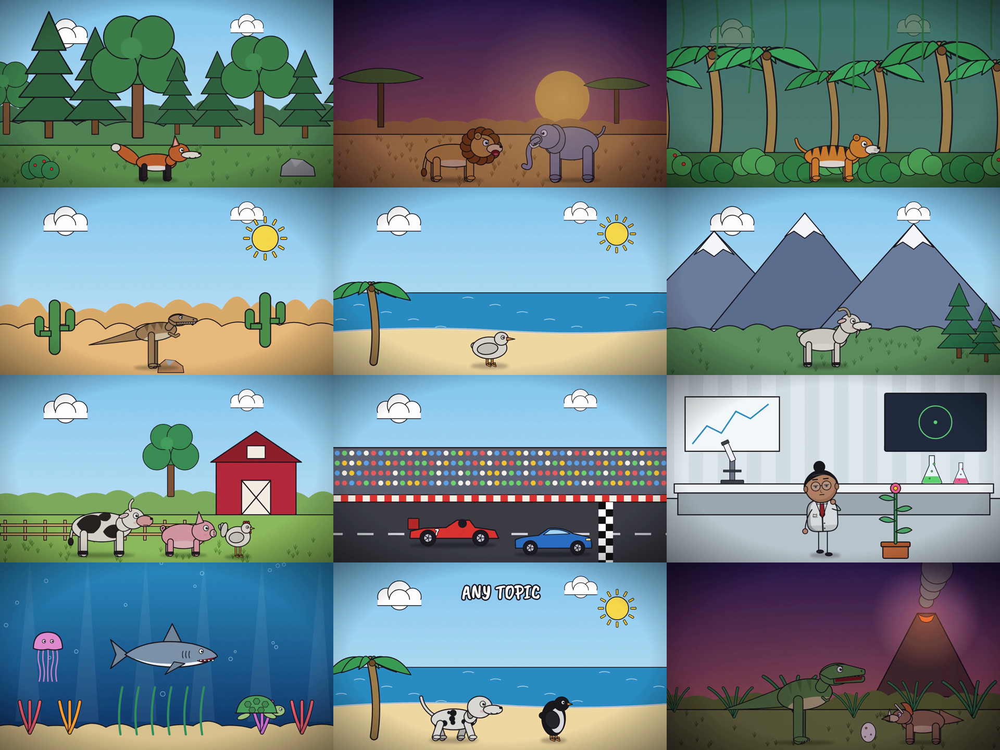
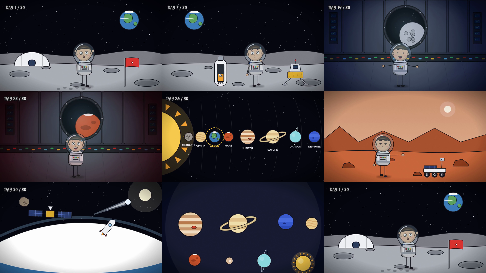

# AnyVideo: Any Topic Animate Video, a skill for Claude and OpenCode

One prompt, any topic or any made-up story: animals, dinosaurs, cars, sports, plants, the solar system, science, history, money, crime, what-ifs, top-10 lists, A-vs-B, and adventures like "I woke up on the Moon and had 30 days to get home".
Topic -> research with sources -> script in the right format -> characters, animals, props and places drawn in code -> your voiceover or a generated one checked by speech recognition -> animated 16:9 video (8-15 min) with music and sound effects -> frame-by-frame QA -> YouTube package.
Built on the RobbiSkill (Paper Billions) engine and the EscapeSkill prison sets; everything those skills could do still works here.





## What it can draw out of the box (full list: `style/LIBRARY.md`)
- **40 sets:** space (Moon surface with Earth in the sky, Mars, the whole solar system, Earth/Mars from orbit, spaceship interior, deep space), nature (forest, savanna, jungle, desert, mountains, beach, underwater ocean, farm, prehistoric volcano), science/space (lab, space with planets or moon ground), sport/vehicles (stadium for soccer/football/basketball/track, racetrack, garage), general (plain colour, classroom, city, street, living room, stage), money (office, boardroom, trading floor, vault, server room, capitol, world map) and prison (cell, cell block, yard, wall with searchlight, tunnel, sewer, shore). Day, dusk, night and red-alert lighting.
- **People:** cartoon puppets with hair, glasses, beards, hats, suits, astronaut suits with space helmets, jumpsuits, guard uniforms, numbers; 12 moods, 17 poses, lip-sync.
- **22 animals and dinosaurs:** dog, wolf, fox, cat, lion, tiger, bear, rabbit, elephant, cow, pig, goat, sheep, horse, chicken, rooster, duck, T-rex, raptor, stegosaurus, triceratops, brachiosaurus. They walk, talk, roar and change mood. New ones start from a preset (`{"base":"dog","color":"#fff","pattern":"spots"}`).
- **Every planet:** Sun, Mercury, Venus, Earth (continents turn), Moon, Mars, Jupiter (bands, red spot), Saturn (ring), Uranus, Neptune, Pluto (heart).
- **35+ props:** moon lander, rover, satellite, asteroid, comet, flag, oxygen meter that drains, footprints, cars (sedan, sports, truck, race car with spinning wheels), trees, pines, palms, bushes, flowers, a plant that grows on screen, rocks, clouds, sun, planets, rocket, globe, microscope, flask, balls (soccer, basketball, football, tennis), trophy, egg (cracks), bone, fossil, sign, house, fish, plus shark, turtle and jellyfish from the library. Plus all the story graphics: counters, stamps, documents, calendars, map pins, arrows, charts, cash, fire.

## The library grows
When a video needs something new (a beetle, a submarine, a volcano interior), Claude draws it in code in the same style, test-renders it, and saves it:
- `library/<topic>.js` for things every later video can reuse (loaded automatically),
- the project's `custom.js` (listed in `timeline.json` as `"library":["custom.js"]`) for one-off things,
then adds a line to `style/LIBRARY.md`. `library/sea_life.js` and `example_any/custom.js` show both.

## Video formats
True story · Explainer · What if · Top list · Versus · Timeline · Adventure (fiction). Each has its own script shape and recurring on-screen device (countdown badge, score bar, step badge, flipping calendar, real-vs-what-if split screen, DAY n / 30 badge with a draining oxygen meter).

## Install
Claude Code: copy the folder to `~/.claude/skills/AnyVideoSkill/` (or `.claude/skills/` in a project). OpenCode: `~/.config/opencode/skills/AnyVideoSkill/`. Restart the app.

## First run
```
python scripts/setup.py          # checks Python 3.10+, ffmpeg; installs packages. Prints "All set"
python scripts/setup.py --voice  # optional: built-in voice + speech-recognition models (~850 MB, once)
python scripts/selftest.py       # renders the bundled example. Prints "SELFTEST PASSED"
python engine/render.py example_any/timeline.json --draft --out /abs/path/any.mp4   # library + custom drawings
```
Mac/Linux: `python3`. Install ffmpeg first (Windows: `winget install ffmpeg`; Mac: `brew install ffmpeg`). If Playwright's own Chromium is missing, set `ESCAPESKILL_CHROMIUM=/path/to/chrome`.

## Use
`/anyvideo` or "Make an Any Topic Animate Video about <topic>". Seven one-question stages: length, topic (or your own story idea), format, script + plan, look check, voice + draft, YouTube package.

## Speed
About 0.12 s per frame on 2 CPUs: a 10-minute video takes roughly 35-50 minutes to render. Shots are cached, so edits re-render only what changed.

## Status (honest)
Tested on Linux: setup, selftest, every set, all 22 creatures, all props, the library loader and a project `custom.js`, each rendered and checked frame by frame. Not tested yet: a full 10-minute video in each format end to end, Windows/Mac. Drawings are deliberately simple flat cartoons; detailed subjects become friendly cartoon versions.
