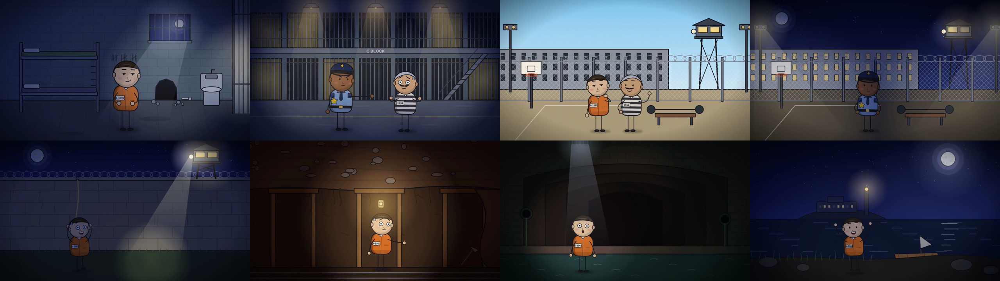

# EscapeSkill: Great Escapes Animate Video, a skill for Claude and OpenCode

One prompt: a real prison escape -> research with sources -> script -> prisoners, guards and prison sets drawn in code -> your voiceover or a generated one checked by speech recognition -> animated 16:9 video (8-15 min) -> sound -> QA -> YouTube package.
Style: flat 2D cartoon, one small "diorama" per sentence, night lighting. Original characters and scripts. Built on the RobbiSkill (Paper Billions Animate Video) engine.



## What's new compared with RobbiSkill
- **7 prison sets** (`engine/sets.js`): `cell` (optional dug hole, ceiling lamp), `cellblock` (two tiers, walkway, stairs), `yard` (day or floodlit night, fence, razor wire, guard tower), `wall` (tower with a **sweeping searchlight**, optional rope), `tunnel` (timber frames, lantern, rails, dig face), `sewer` (brick arches, water, moonlight shaft), `shore` (island prison across the water, optional raft).
- **Prison outfits** (`engine/puppet.js`): `outfit: jumpsuit | stripes | guard`, inmate `number` patch, `hat: cap | beanie`.
- **Sweeping lights**: any light or cone can take `sweep` (pixels) and `speed`.
- **Escape storytelling** in `SKILL.md`: idea search for lesser-known escapes, story shape (prison, plan, night, manhunt, ending), content rules (history not a how-to, no gore, careful with real people), escape devices in `style/STYLE.md`.
- `ESCAPESKILL_CHROMIUM=/path/to/chrome` lets the renderer use an existing Chromium when Playwright's download is missing.

## Install
Claude Code: copy the folder to `~/.claude/skills/EscapeSkill/` (or `.claude/skills/` in a project).
OpenCode: `~/.config/opencode/skills/EscapeSkill/`. Restart the app.

## First run
```
python scripts/setup.py          # checks Python 3.10+, ffmpeg; installs packages. Prints "All set"
python scripts/setup.py --voice  # optional: built-in voice + speech-recognition models (~850 MB, once)
python scripts/selftest.py       # renders the bundled example. Prints "SELFTEST PASSED"
python engine/render.py example_escape/timeline.json --draft --out /abs/path/sets.mp4   # every prison set, 18 s
```
Mac/Linux: `python3`. Install ffmpeg first (Windows: `winget install ffmpeg`; Mac: `brew install ffmpeg`).

## Use
Write: `Make a Great Escapes Animate Video about <escape>` or `/escapeskill`. Answer the six one-question stages, approve the diorama plan ("Build it?"), send or generate the voice, review the draft, get the MP4 and `package.md`.

## Speed
About 0.12 s per frame on 2 CPUs: the 18-second set preview renders in about 40 s; a 10-minute video takes roughly 35-50 minutes. Shots are cached, so edits re-render only what changed.

## Status (honest)
Tested on Linux: setup, selftest, all 7 prison sets rendered with prisoner/guard puppets and checked frame by frame, the sweeping searchlight. Not tested yet: a full 10-minute escape video end to end, Windows/Mac, the optional Google Flow mode for prison places.
